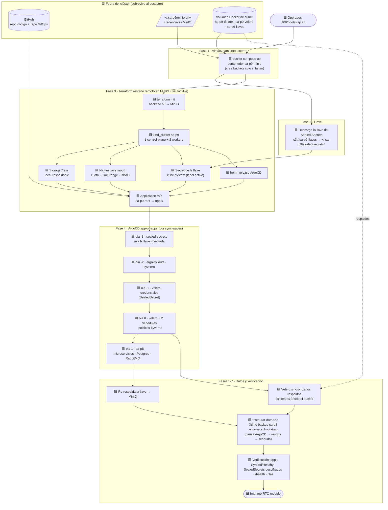

# Diagrama del bootstrap — Práctica 9

Orden de reconstrucción y dependencias entre componentes cuando se corre
`./P9/bootstrap.sh` después de perder el clúster. Cada caja depende de
las que tiene encima: no puede empezar hasta que esas terminen sanas.

**Leyenda:**
- 🟦 **Automático:** lo hace el bootstrap sin intervención.
- 🟨 **Sobrevive al desastre:** existe antes y fuera del clúster; el bootstrap lo lee, no lo crea.
- 🟥 **Manual:** lo hace una persona.

En la reconstrucción solo hay **un** paso manual: lanzar el comando.

## Por qué este orden

| Dependencia | Qué pasa si se invierte |
|---|---|
| MinIO **antes** de Terraform | `terraform init` no encuentra el backend y no sabe qué existía: sin estado no hay reconstrucción reproducible. |
| Llave **antes** del controlador de Sealed Secrets | El controlador genera una llave nueva y los SealedSecrets del repo GitOps quedan ilegibles para siempre en ese clúster. Por eso Terraform crea el Secret de la llave antes de `sa-p9-root` (`depends_on` en `argocd.tf`). |
| Namespace, RBAC y StorageClass **antes** de la app raíz | Los charts usan `serviceAccount.create=false`, `CreateNamespace=false` y la StorageClass `local-respaldable`: sin ellos los pods no arrancan o el volumen de Postgres no se puede respaldar. |
| Ola -3 → -2 → -1 → 0 → 1 | Cada ola usa los CRDs o secretos de la anterior: `velero-credenciales` es un SealedSecret (necesita la ola -3); `sa-p8` usa `Rollout` (ola -2) y sus pods pasan por las políticas de Kyverno (olas -2 y 0). Una ola no empieza hasta que la anterior está `Healthy` (health check de `Application` en `P9/terraform/values/argocd.yaml`). |
| Restauración **después** de que `sa-p8` esté sano | Velero restaura el StatefulSet de Postgres con su volumen; si ArgoCD siguiera con `selfHeal`, recrearía Postgres con un disco vacío antes de la restauración. Por eso `restaurar-datos.sh` pausa `sa-p9-root` y `sa-p8` y los reactiva al terminar. |
| Solo backups **anteriores** al bootstrap | El Schedule horario usa `skipImmediately: true` para no guardar la base vacía del clúster nuevo como "el respaldo más reciente", y el bootstrap ignora cualquier respaldo creado después de su inicio. |

## Lo que no es automático

| Paso | Por qué sigue siendo manual | Dónde está documentado |
|---|---|---|
| Lanzar `./P9/bootstrap.sh` | Decidir que hay un desastre es una decisión humana. | [Runbook §1](Runbook_Recuperacion.md#1-pérdida-total-del-clúster) |
| Recrear `~/.sa-p9/minio.env` si se pierde la máquina | Son credenciales: no deben estar en ningún repositorio. | Informe de DR, puntos únicos de fallo |
| Regenerar secretos si se pierden **las dos** copias de la llave | Requiere conocer los valores en claro. | [Runbook §4.3](Runbook_Recuperacion.md#43-si-no-existe-ninguna-copia-de-la-llave) |
